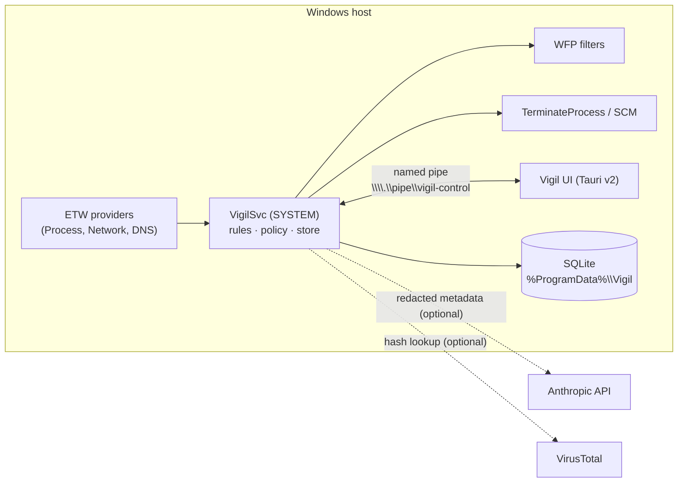

# 00 — Overview

**Tóm tắt (VI):** Vigil giám sát process và kết nối mạng trên Windows, chấm điểm tin cậy, tự cho phép/chặn/hỏi. Tài liệu này nêu tầm nhìn, phạm vi, thuật ngữ và nguyên tắc thiết kế.

## 1. Problem

Endpoints run hundreds of processes and services that open outbound connections. Operators cannot tell which are legitimate, and attackers exploit this by (a) running unsigned payloads from user-writable paths, (b) masquerading as system binaries, (c) abusing signed built-in tools (LOLBins), and (d) impersonating trusted publishers. Existing options are heavyweight EDR suites or simple firewalls that ask the user without context.

## 2. Vision

A lightweight, explainable, local-first guard that answers one question per executable and connection: **"Is this safe to talk to the Internet?"** Answers are Safe, Unknown, or Malicious, each with machine-readable reasons, and each mapped to a deterministic action.

## 3. Goals

- G1. Inventory all processes and TCP/UDP connections in real time with signature and publisher identity.
- G2. Trust verified publishers automatically while detecting forgery and masquerading.
- G3. Enforce: Safe → pass, Unknown → block + ask, Malicious → block + kill + prevent respawn.
- G4. Optional AI second opinion (Claude) in **Advisor** or **Auto** mode with strict privacy and safety limits.
- G5. A modern, fast UI (Tauri v2) with realtime views and a frictionless approval popup.
- G6. Auditable: every verdict, decision and action is logged with reasons.

## 4. Non-goals (v1)

- Kernel driver, packet-hold (pending-packet) inspection, ELAM/PPL self-protection.
- Deep packet inspection, TLS interception, DNS filtering.
- Full AV/EDR: no file scanning engine, no memory forensics beyond the M6 unbacked-executable-memory check.
- Cloud console, multi-tenant management, auto-update.
- Linux/macOS support.

## 5. Users

| Persona | Need |
|---|---|
| IT/Security admin | Deploy on endpoints/servers, review Unknown queue in bulk, export audit. |
| Power user | Run on own machine, get clear prompts, use AI to reduce prompts. |
| Auditor | Evidence of malware protection, monitoring and logging controls. |

## 6. Glossary

| Term | Meaning |
|---|---|
| **Identity** | `(sha256, normalized path, signer thumbprint or none)`; the unit that is scored and decided on. |
| **Signal** | A named observation with a weight, e.g. `SIG-002 pinned_publisher_valid` (+40). |
| **Score** | `clamp(50 + Σ weights, 0, 100)` after caps. |
| **Verdict** | `safe` (≥80), `unknown` (30–79), `malicious` (≤29 or hard rule). |
| **Hard rule** | Terminal rule (HR-*) forcing `malicious`, or hard-allow (HA-*) forcing `safe`. |
| **Decision** | User/AI action: `allow`, `block`, `kill`, with a scope and an `apply_to`. |
| **Mode** | `observe` (log only), `learning` (no blocking, build Unknown queue silently), `enforce`. |
| **Pending** | An Unknown identity awaiting a decision. |
| **LOLBin** | Signed OS binary commonly abused for malicious activity (e.g. `mshta.exe`). |
| **Masquerade** | A binary pretending to be another (name, path, parent, or publisher). |

## 7. Design principles

1. **Explainability over magic:** every verdict lists signals; the UI shows them.
2. **Deterministic core, advisory AI:** AI augments, never replaces, hard rules.
3. **Safe failure:** service failure never takes the network down; unknown apps stay blocked while service is healthy.
4. **Least privilege & minimal data:** UI cannot read secrets; AI gets minimal redacted metadata.
5. **Reversible by default:** disable before delete, backups for every persistence change.
6. **Data-driven rules:** behaviour changes ship as rule files, not code.

## 8. System context

## 9. Success metrics

- ≥ 95% of processes on a clean Windows 11 + Office + browser image classified Safe with zero prompts after learning mode.
- 100% detection of the masquerade/tamper test corpus in `docs/11-testing.md`.
- Idle service CPU < 2%, RSS < 150 MB; cached evaluation p95 < 150 ms.
- Zero network-outage incidents attributable to service failure in the soak test.
