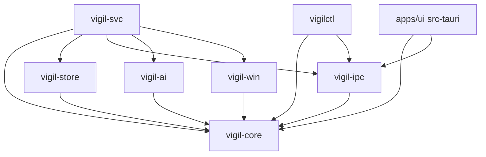
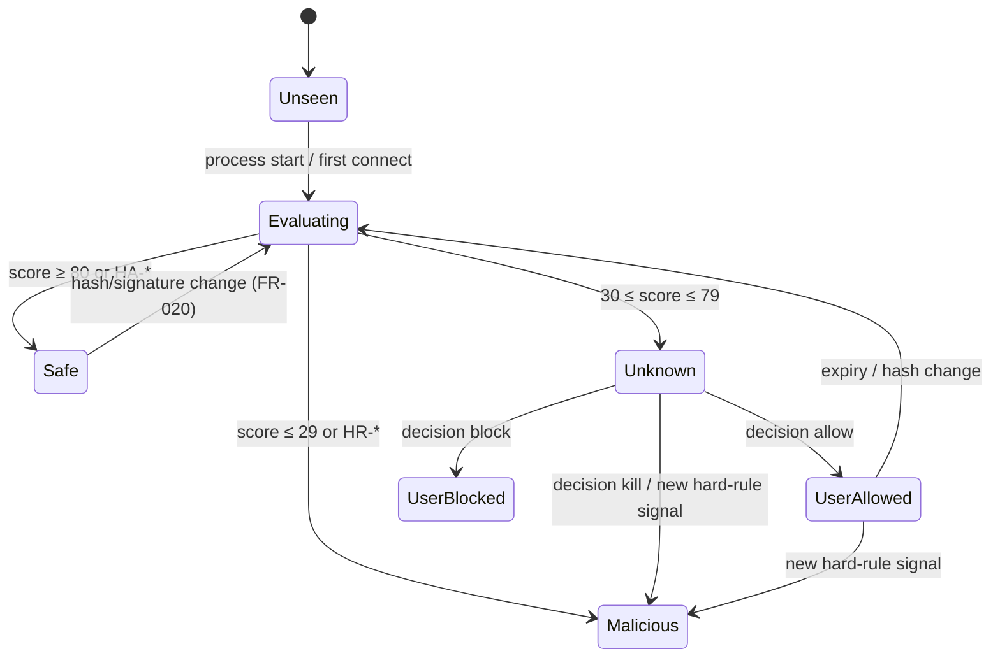

# 02 — Architecture

**Tóm tắt (VI):** Service Rust chạy SYSTEM xử lý pipeline sự kiện → bổ sung identity → chấm điểm → chính sách → thi hành → phát sự kiện ra UI. Logic thuần nằm trong `vigil-core` để test được trên mọi OS; mọi `unsafe` nằm trong `vigil-win`.

## 1. Components

| Component | Runs as | Responsibility |
|---|---|---|
| `VigilSvc` (`vigil-svc`) | SYSTEM service | Orchestrator: collectors, evaluator, policy, enforcement, IPC server, AI client, store. |
| `vigil-win` | in-proc lib | ETW sessions, WFP engine/filters/net events, WinVerifyTrust, version info, process/SCM control, persistence scanners. |
| `vigil-core` | in-proc lib | Types, rule engine, scoring, masquerade logic, policy decision table, beacon detector, redaction. |
| `vigil-store` | in-proc lib | SQLite (WAL), migrations, audit hash chain, retention jobs. |
| `vigil-ipc` | in-proc lib | Framing, JSON-RPC types, client + server helpers for the named pipe. |
| `vigil-ai` | in-proc lib | Anthropic Messages API client, prompt builder, cache, budget/rate limiting. |
| `vigilctl` | CLI (admin) | Status, mode, decisions, panic, export, diagnostics over IPC. |
| Vigil UI (`apps/ui`) | user session, elevated | Tauri v2 shell (Rust bridge owns the pipe) + React front end + tray + popup window. |

## 2. Dependency graph (enforced in CI by `cargo deny` / `cargo-modules` check)



## 3. Runtime pipeline

```mermaid
flowchart LR
  A[Collectors\nETW process/net/dns\n+ snapshot reconciler] --> B[Enricher\nhash · signature · version info\nparent chain · path class]
  B --> C[Evaluator\nrules → signals → score\nhard rules]
  C --> D{Policy\ndecision table}
  D -->|safe| E1[Permit filter]
  D -->|unknown| E2[Pending + popup\n(AI optional)]
  D -->|malicious| E3[Deny filter + kill\n+ respawn watch]
  E1 & E2 & E3 --> F[Audit + Store]
  F --> G[IPC event stream → UI]
```

### Stages
1. **Collect:** ETW callbacks run on dedicated OS threads and push compact structs into bounded `tokio::mpsc` channels (drop-oldest metric + counter on overflow). A 5 s reconciler diffs `GetExtendedTcpTable/UdpTable` and process snapshots to repair lost events.
2. **Enrich:** resolve path (`QueryFullProcessImageNameW`), stat → `(path,size,mtime)` cache → SHA-256, signature (catalog first, then embedded), VersionInfo, path class, parent chain (walk PPID with start-time check to defeat PID reuse).
3. **Evaluate:** `vigil-core::evaluate(&Facts) -> Evaluation { score, verdict, signals[], hard_rule? }`. Static facts are cached by identity; dynamic signals (beaconing, destinations) re-evaluate per connection.
4. **Decide:** `policy::decide(mode, evaluation, user_decisions, ai_opinion?) -> Action`. Pure function; the decision table is in §5.
5. **Enforce:** apply WFP/kill actions via `vigil-win`, idempotently, with audit rows before and after.
6. **Emit:** diffs to subscribed UI clients via IPC events (batched).

## 4. Concurrency model

- One tokio multi-thread runtime; blocking Win32 calls (`WinVerifyTrust`, hashing) go to `spawn_blocking` with a bounded semaphore (default 4) to protect latency.
- Single-writer actor for the SQLite connection; readers use a small pool.
- Per-identity in-flight map (`DashMap<IdentityKey, Notify>`) coalesces duplicate evaluations when many processes of the same binary start together.
- Enforcement actor serializes WFP mutations (transactions via `FwpmTransactionBegin0/Commit0`).

## 5. Policy decision table (authoritative)

Precedence: HA-001 and safe-guards (SG-001) → hard rules (HR-*) → user decisions (HA-002) → AI (Auto) → score thresholds.

| Mode | Verdict | Network | Process | UI |
|---|---|---|---|---|
| `observe` | any | not touched | not touched | events + alerts only |
| `learning` | safe | pass | — | none |
| `learning` | unknown | pass (no catch-all block) | — | queued silently in Pending (bulk review wizard) |
| `learning` | malicious | pass | — | high-severity alert only |
| `enforce` | safe | permit filter | — | none |
| `enforce` | unknown | catch-all block applies | — | Pending + popup (or AI decides in Auto) |
| `enforce` | malicious | persistent deny | kill + respawn watch | alert + audit |

User `allow` on an Unknown identity → permit filter (`once` is removed when the process exits or after 10 min of inactivity). User `block` → persistent deny. User `kill` → kill + persistent deny + respawn watch. A user `allow` never overrides a hard rule; the UI explains why instead.

## 6. Identity state machine



## 7. Process model and privileges

- Service: `LocalSystem`, `SERVICE_AUTO_START`, delayed start off (must start before user apps), recovery: restart after 5 s, 30 s, 60 s; reset period 1 day. Accepts `SERVICE_CONTROL_STOP` only from Administrators (service DACL).
- UI: manifest `requireAdministrator` for the main window (state-changing); tray + popup run in the same elevated process. A non-elevated launch of the UI connects as `viewer` (read-only).
- Data dir `%ProgramData%\Vigil\` with ACL SYSTEM + Administrators full control, no Users access; subfolders `logs`, `rules.d`, `backup`.

## 8. Configuration layering

1. Embedded defaults (`config/default-policy.toml`, `rules/*.toml`).
2. `%ProgramData%\Vigil\config.toml` and `rules.d\*.toml` (admin overrides; validated on load; invalid files are rejected with an audit entry and the previous config stays active).
3. Runtime settings in SQLite (`settings` table) changed through IPC.

## 9. Error handling and health

- Library crates return typed errors; the service converts to health states: `Healthy`, `Degraded(reason)`, `Failed(reason)` published as `event.health`.
- ETW session loss → restart session, run reconciler immediately, mark `Degraded` until stable for 60 s.
- WFP engine failure → fail open (remove dynamic filters), alert, retry with backoff.
- AI failure/timeouts → fall back to Pending/user decision; never block the pipeline.

## 10. Logging

`tracing` JSON lines to `%ProgramData%\Vigil\logs\vigil-svc.log.*` (daily rotation, 14 days). Log levels configurable at runtime. Never log API keys, full command lines (hash them) or user file contents.

## 11. Versioning

SemVer for the app; IPC `protocol` integer (currently `1`); SQLite `user_version` migrations; rule pack has `rule_pack_version` stored with every evaluation so verdicts are reproducible.
