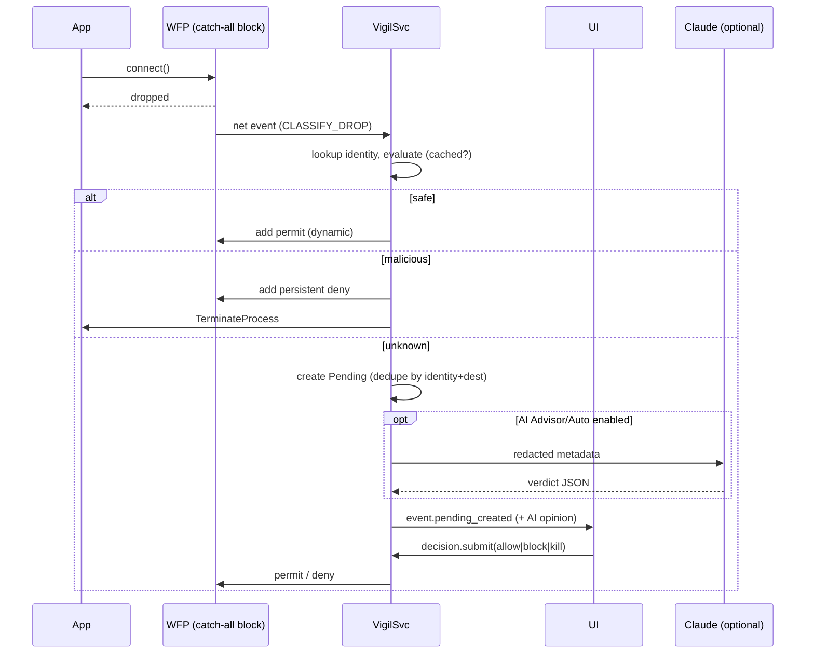

# 04 — Enforcement: WFP, kill, anti-respawn, persistence audit

**Tóm tắt (VI):** Vigil dùng WFP filter (không cần driver) ở tầng ALE để chặn theo đường dẫn app, `TerminateProcess` để kill, theo dõi ETW để kill lại khi bật lại, và quét các điểm persistence để người dùng duyệt. Filter chặn mặc định là *dynamic* nên service chết thì mạng vẫn thông (fail-open).

## 1. WFP design

| Item | Decision |
|---|---|
| Engine session | `FwpmEngineOpen0` with a **dynamic** session for catch-all and permit filters (removed automatically when the engine handle closes). |
| Providers | `Vigil.Dynamic` (session-scoped) and `Vigil.Persistent` (explicit deny filters; survive service stop and reboot). Both have fixed GUIDs defined in `vigil-win::wfp::ids`. |
| Sublayer | One own sublayer per provider, high weight so Vigil is evaluated early. Note: block in any sublayer overrides permits in others, so a Vigil permit never bypasses Windows Defender Firewall. |
| Layers | `FWPM_LAYER_ALE_AUTH_CONNECT_V4/V6` (outbound). `FWPM_LAYER_ALE_AUTH_RECV_ACCEPT_V4/V6` (inbound) only for explicit denies when `enforcement.block_inbound` is on (FR-017, off by default); there is no inbound catch-all, so programs that are not blocked keep accepting connections. |
| Conditions | `FWPM_CONDITION_ALE_APP_ID` via `FwpmGetAppIdFromFileName0(path)`; optional `IP_REMOTE_ADDRESS`/`IP_REMOTE_PORT`. UWP/AppContainer: `FWPM_CONDITION_ALE_PACKAGE_ID` (package SID) in M4. |
| Filter weights (within sublayer) | explicit deny = 15, loopback exemption = 12, explicit permit = 10 (includes Vigil's own binaries, which therefore reach Anthropic/VirusTotal when enabled), **catch-all block for non-evaluated apps = 1**. |
| Loopback | Always permitted: a high-weight permit with the `FWPM_CONDITION_FLAGS` condition set to `FWP_CONDITION_FLAG_IS_LOOPBACK`. The catch-all never applies to loopback. |
| Transactions | All multi-filter changes inside `FwpmTransactionBegin0/Commit0`; idempotent by filter key (GUID derived from `sha256(identity_key)`), so retries cannot duplicate filters. |
| Net events | Enable `FWPM_ENGINE_COLLECT_NET_EVENTS`; subscribe with `FwpmNetEventSubscribe0` for `CLASSIFY_DROP` to learn about blocked first connections (app path, remote addr/port, filter id) and create Pending items. |

### Verified WFP behaviour (M3 implementation notes)
- `FwpmEngineSetOption0(FWPM_ENGINE_COLLECT_NET_EVENTS)` fails from a dynamic session with `FWP_E_DYNAMIC_SESSION_IN_PROGRESS` (0x8032000B). `Engine::open_dynamic` sets this global option through a short-lived non-dynamic handle.
- Provider/sublayer/filter adds return `FWP_E_ALREADY_EXISTS` on repeat; treated as success (idempotent). Deleting a missing filter (`FWP_E_FILTER_NOT_FOUND`) is also success.
- Filter weights are `FWP_UINT8` (0-15) so the table above maps directly. Each identity has one filter per IP family (v4/v6); keys derive from `sha256("vigil.wfp.v1", kind, family, identity_key)[..16]`.
- Net-event `app_id` is an NT device path; `DropEvent.app_path` is mapped to a Win32 path via `QueryDosDeviceW` when possible. The subscription context is intentionally leaked (one small allocation per subscription) because unsubscribe does not document that in-flight callbacks have finished.

### Fail-open vs persistent
- Catch-all and permits: **dynamic** → if `VigilSvc` crashes/stops, all of them vanish and the machine keeps its network. The service restarts via SCM recovery and rebuilds them from the store within seconds.
- Explicit `block`/`kill`/malicious denies: **persistent** → survive stop/reboot, so a stopped service does not re-enable known-bad apps.
- Inbound denies (FR-017): with `enforcement.block_inbound` on, each explicit deny also gets a persistent `InboundDeny` filter (weight 15) on the accept layer. Turning the setting off or revoking the block removes them; stale ones from an earlier run are cleared with the outbound denies on the first sync. Changing the setting re-syncs the filters at once (`settings.set`).
- Rebuild on start: load identities with active `allow` decisions or Safe verdicts and add permits **before** enabling the catch-all, to avoid a burst of false blocks (`rebuild_then_arm` sequence).

### First-connect race (accepted limitation, C3)
A just-started, not-yet-evaluated app may hit the catch-all and have its first connect dropped. Mitigations: (1) ETW process-start triggers evaluation immediately; Safe identities get their permit within the evaluation latency budget; (2) a **warm cache** of Safe identities is pre-permitted at service start and after installs/updates are detected; (3) the drop event creates the Pending item, and after a decision the app's next retry succeeds. Document this in the UI help text.

### `svchost.exe` and shared hosts
A single `svchost.exe` path covers many services, so path-based permits are coarse. v1 behaviour:
1. `svchost.exe` identity (MS-signed, canonical, correct parent) is Safe → permitted.
2. **Attribution:** map PID → hosted services (`QueryServiceStatusEx` with `SERVICE_STATUS_PROCESS`, `EnumServicesStatusExW`), read each service's `ServiceDll`, verify its signature and score it. Show the service name in the UI.
3. If a hosted `ServiceDll` is unsigned/invalid or in a user-writable path → raise a dedicated alert (`kind = "svchost_service_suspicious"`) and mark the *service* Unknown (the process remains Safe; the user is offered `sc stop` + disable).
4. M4+: per-service filtering using the service SID in `FWPM_CONDITION_ALE_USER_ID` security descriptors (kept as a roadmap item, not required for v1 acceptance).

### System allowlist bootstrap (avoid self-lockout)
Before enabling `enforce`, the service verifies these identities are Safe and permitted: `System` (PID 4), DNS Client, DHCP Client, Windows Time, Windows Update/Delivery Optimization (via `svchost`), Defender, Vigil components, and the configured management agents (Intune, RMM). `learning` mode must run ≥ 1 hour (configurable, default 24 h) before the UI allows switching to `enforce` unless the admin overrides with a confirmation.

## 2. Unknown flow

Pending items are de-duplicated by `(identity, dest_class)`, rate-limited to avoid popup storms (default: max 1 popup per 5 s, others queue with a badge), and persist until resolved. If no decision is made, the identity simply **stays blocked**.

## 3. Kill semantics

1. Resolve the target with `(pid, start_time)` to avoid PID reuse.
2. Check `never_kill`/protected set (SG-001); refuse with `protected_target` unless HR-001/002/003 fired.
3. `OpenProcess(PROCESS_TERMINATE | PROCESS_QUERY_LIMITED_INFORMATION)` → `TerminateProcess(h, 1)`. If access denied (PPL/protected), report `protected_target`/`access_denied`, add the persistent deny filter anyway, and alert.
4. Optional tree kill: enumerate descendants by PPID+start time, terminate leaves first; `kill_tree` default `true` for Malicious, `false` for user `kill` unless ticked.
5. Audit row before and after, including target identity and exit status.

## 4. Anti-respawn (chặn bật lại)

After a `kill`/malicious verdict the identity gets a **block record**:

| Layer | Mechanism |
|---|---|
| Network | Persistent WFP deny by app path (and by AppID of known copies). |
| Process | ETW process-start watch matches by image path **or** sha256 (hash computed on start); on match → `TerminateProcess` within the same event loop tick; counted as `respawn_killed` in audit. |
| Service | If the PID hosts a service: `ControlService(STOP)`, then (after approval, default prompt) `ChangeServiceConfigW(SERVICE_DISABLED)`; the previous start type is saved to `persistence_backups`. |
| Persistence | Run persistence audit (§5) for the image path; present findings in the UI for approval. |
| Hash rename | Match by sha256 so renamed copies are caught after start; WFP deny is also added for each new path observed. |

Limits (documented in the UI): code that runs inside another process (injection), very short-lived processes that finish before kill, and kernel-level malware are out of scope for user-mode enforcement (`docs/08`).

## 5. Persistence audit

Scanners run on demand and when a block record is created. Each finding is a `PersistenceItem { kind, location, image_path, command, args_hash, owner, first_seen, risk_note }`.

| Kind | Locations |
|---|---|
| `run_key` | `HKLM/HKCU\...\Run`, `RunOnce`, `Wow6432Node` variants, `RunServices`, `Policies\Explorer\Run` |
| `service` | `HKLM\SYSTEM\CurrentControlSet\Services\*` (`ImagePath`, `ServiceDll`, start type) |
| `scheduled_task` | Task Scheduler COM (`ITaskService`) — actions with `Exec` |
| `startup_folder` | per-user and common Startup folders |
| `wmi_subscription` | `root\subscription` filters/consumers/bindings |
| `ifeo` | `Image File Execution Options\*\Debugger` and `GlobalFlag` |
| `appinit` | `AppInit_DLLs`, `LoadAppInit_DLLs` |
| `winlogon` | `Shell`, `Userinit`, `Notify` |
| `shell_ext` | Browser helper objects and shell extension handlers (informational) |

Actions (all require explicit user approval, all audited):
- **Disable** (default): reversible; stores the original value/definition (and for tasks the exported XML) in `persistence_backups`; UI offers **Restore**.
- **Delete**: only available after Disable and a second confirmation; never for items whose image is in the never-kill/system set.
- Vigil never deletes files on disk in v1.

### Malicious containment (outside `observe`)

When a program becomes Malicious because a **hard rule** fired (not by score or AI alone; a score-only Malicious waits for the advisor and the list, and builds before this rule had their score-only blocks lifted at startup), `raise_malicious` queues the pending item and immediately records a persistent, revocable `Block` decision (`by = rule`, scope `forever`, `apply_to = file`, audit outcome `contained`). The network is cut at once; killing stays the user's choice in the popup. The never-kill set is skipped unless HR-001, HR-002 or HR-003 fired. `observe` mode never contains. Covered by `malicious_is_contained_by_a_block_outside_observe` and `observe_mode_never_contains`. Enforce mode keeps its separate `auto_kill_malicious` (section 3).

## 6. Modes and arming

| Transition | Rule |
|---|---|
| `observe → learning` | allowed any time |
| `learning → enforce` | requires learning age ≥ policy minimum or admin override; runs `rebuild_then_arm` and the system allowlist bootstrap check; refuses if the bootstrap check fails |
| `enforce → learning/observe` | immediate; removes catch-all, keeps persistent denies unless `clear_denies = true` |
| Panic | `enforcement.panic` removes **all** Vigil filters (dynamic and persistent), sets mode `observe`, audits, and raises a UI banner; re-arming requires an explicit admin action |

## 7. Failure handling matrix

| Failure | Behaviour |
|---|---|
| WFP engine open/add fails | Mode forced to `observe`, health `Failed`, alert, retry with backoff (1, 5, 30 s). |
| Filter add partially fails inside a transaction | Abort transaction (all-or-nothing), audit, retry. |
| Service crash | Dynamic filters vanish (fail-open); persistent denies remain; SCM restarts service; `rebuild_then_arm`. |
| Evaluator exception for an identity | Treat as Unknown (not Safe), log with identity key, continue. |
| Clock jump | Decision expiry uses monotonic + wall clock check; prefer the earlier expiry. |

## 8. Process storms (all modes)

`storm_scan` (observer tick) asks `vigil_core::storm::detect` for parents whose live children show self-replication (≥ 12 children running the parent's own image, or ≥ 6 nested same-image generations) or a launch flood (≥ 10 script hosts / LOLBins such as `cmd`, `powershell`, `wscript`, `mshta`, `rundll32`). The parent's whole tree is killed (leaves first) and its image blocked, **in every mode, including `observe`**, because a block alone does not stop a program that keeps spawning.

Exempt: verified-safe programs (a browser legitimately runs many same-image children) and the never-kill set (SG-001). Both exemptions are gated by tests in `tests/kill.rs`. The kill writes the usual audit row and the block can be revoked like any other.

**Adaptive thresholds.** The standing limits above are the safe default for slow, simple cases. Speed tightens them: ≥ 5 same-image children (or ≥ 4 script hosts) born within 10 s of each other trip immediately, so a fast clone is killed in one tick while the same count spread over minutes is left alone. A Safe program is exempt only from the sibling-clone count; a nested chain or a script-host flood reclassifies it Malicious (signal `STM-001`) and it is killed like any other. 

**AI judgement below the thresholds.** A not-yet-Safe parent with ≥ 3 copies or script hosts, short of every kill threshold, is put to the advisor once per run (signal `STM-002`, "Repeated child launches"). In `enforce` with AI mode `auto`, a `malicious` opinion at confidence ≥ `auto_threshold` reclassifies it and kills the tree (actor `ai`, audit `storm_kill`); otherwise the opinion is only recorded (`storm_noted`) and the user decides. Safe and never-kill programs are never asked about. Validly signed programs are exempt from the count-based Replication and LaunchFlood kills (Electron apps fork many same-image children, IDE agents such as Kiro run many shells) and go to the advisor instead; only nested self-copies (`Chain`) are killed regardless.
