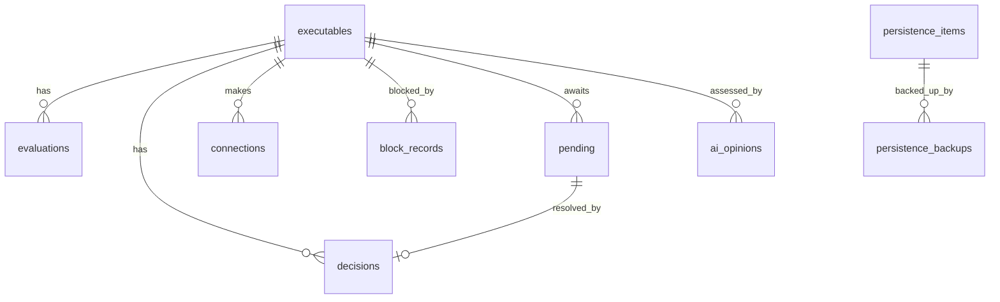

# 09 — Data model

**Tóm tắt (VI):** SQLite (WAL) tại `%ProgramData%\Vigil\vigil.db`. Schema chuẩn trong `schemas/db.sql`. Audit log là chuỗi băm (hash chain) để phát hiện sửa/xóa.

## 1. Storage

- Engine: SQLite with `journal_mode = WAL`, `synchronous = NORMAL`, `foreign_keys = ON`, `busy_timeout = 5000`; single writer actor, read-only pool.
- Migrations via `PRAGMA user_version` and ordered SQL files embedded in `vigil-store` (`migrations/0001_init.sql` is `schemas/db.sql`).
- File ACL: SYSTEM + Administrators only. Backups: `vigil.db` copied to `backup\` on schema upgrade.

## 2. Entity overview



## 3. Tables (summary)

| Table | Purpose | Key columns |
|---|---|---|
| `executables` | One row per identity | `id`, `sha256`, `path`, `signer_thumbprint`, `publisher`, `company`, `product`, `original_filename`, `signature_status`, `first_seen`, `last_seen`, `package_family?` (migration 0003) — unique `(sha256, path, signer_thumbprint)` |
| `evaluations` | Verdict history | `executable_id`, `score`, `verdict`, `hard_rule`, `signals_json`, `rule_pack_version`, `source`, `evaluated_at` |
| `decisions` | User/AI/rule decisions | `executable_id`, `action`, `scope`, `apply_to`, `publisher_thumbprint?`, `publisher_product?`, `package_family?` (required for `package_source`), `expires_at`, `by`, `actor`, `note`, `created_at`, `revoked_at` |
| `pending` | Awaiting decisions | `executable_id`, `dest_class`, `dest_addr`, `dest_port`, `created_at`, `resolved_at`, `resolution_decision_id` |
| `connections` | Connection history (retention 30 d) | `executable_id`, `pid`, `proto`, `direction`, `local_addr`, `remote_addr`, `remote_port`, `dns_name`, `state`, `first_seen`, `last_seen`, `blocked` |
| `block_records` | Anti-respawn records | `executable_id`, `sha256`, `path`, `reason`, `respawn_kills`, `created_at` |
| `trust_publishers` | Built-in and user pins | `subject_org`, `thumbprint`, `source` (`builtin|user`), `note`, `created_at` |
| `persistence_items` | Scan findings | `kind`, `location`, `image_path`, `command`, `status` (`found|disabled|deleted|restored`) |
| `persistence_backups` | Reversible changes | `item_id`, `backup_json`, `created_at` |
| `ai_cache` / `ai_opinions` | Opinion cache and history | cache key, `verdict`, `confidence`, `recommended_action`, `reasons_json`, `model`, `created_at`, `expires_at` |
| `settings` | Runtime settings | `key`, `value` (JSON or BLOB for the encrypted key) |
| `audit_log` | Hash-chained audit | `seq`, `ts`, `actor`, `kind`, `target`, `details_json`, `prev_hash`, `hash` |
| `meta` | Schema/rule info | `key`, `value` |

## 4. Audit hash chain

```
hash_n = SHA-256( prev_hash || seq || ts || actor || kind || target || canonical_json(details) )
```

- Encoding: `seq` is 8 bytes big-endian; `ts`, `actor`, `kind` and `canonical_json(details)` are each prefixed with their UTF-8 byte length (u32 big-endian); `target` is a presence byte (0/1) followed by the length-prefixed text, so field boundaries and `NULL` vs empty are unambiguous.
- `prev_hash` of `seq = 1` is 32 zero bytes. `canonical_json` = RFC 8785 JCS.
- `audit.query` verifies the chain over the requested range and returns `chain_ok`. A break is reported as an alert `audit_chain_broken` with the first bad `seq`.
- Daily anchor row stores the latest hash in `meta`. With `event_log.enabled` every row, hash included, is also copied to the Windows Event Log (§4.1), so tampering with the DB alone is detectable against that copy.
- Audit `kind` values: `service_start`, `service_stop`, `mode_change`, `verdict`, `decision`, `decision_revoked`, `kill`, `respawn_kill`, `filter_add`, `filter_remove`, `panic`, `ai_decision`, `ai_config`, `rule_change`, `trust_change`, `persistence_action`, `client_connect`, `config_change`, `health`, `audit_checkpoint` (written by retention purge).

### 4.1 Windows Event Log copy (opt-in `event_log.enabled`, default off)

- After a row is appended, the service writes it to the **Application** log, source `Vigil`, so Windows Event Forwarding or a SIEM agent can collect it. Nothing leaves the machine unless the owner forwards the log.
- Source registration: `HKLM\SYSTEM\CurrentControlSet\Services\EventLog\Application\Vigil`, `EventMessageFile` = `%SystemRoot%\System32\EventCreate.exe` (its message table maps ids 1–1000 to `%1`), `TypesSupported` = 7. Written by the MSI and again, idempotently, by the service at start.
- Event id = 100 + position of `kind` in the list above (`service_start` = 100 … `audit_checkpoint` = 119). Level: Warning for `kill`, `respawn_kill`, `panic`, `health`; Information otherwise.
- Message: one JSON object `{seq, ts, actor, kind, target, details, hash}` (hash in hex), passed as the only insertion string. Every `%` is written as `\u0025`, so host strings such as `%1` in a path are never expanded by Event Viewer. If the text would exceed 16 KiB, `details` becomes `{"truncated": true}`; `seq` and `hash` stay so the row can be matched with the DB.
- A failed write is logged (`event log write failed`) and never blocks the audit append. Code: `vigil_core::audit_export`, `vigil_win::eventlog`, `Shared::audit`.

## 5. Retention (configurable in `config/default-policy.toml`)

| Data | Default |
|---|---|
| `connections` | 30 days (aggregated daily counts kept 365 days) |
| `evaluations` | latest 20 per executable + all verdict changes |
| `audit_log` | 365 days (export before purge; purge keeps the chain by writing a checkpoint row) |
| `ai_opinions` | 90 days |
| logs | 14 days |

## 6. Privacy

- Command lines stored only as hash + first 200 chars when `store_cmdline = true` (default `false`: hash only).
- Paths contain usernames; exports offer `anonymize_paths = true`.
- No data leaves the machine except AI/VT calls as defined in `docs/06`.

## 7. Identity key

`identity_key = sha256_hex || '|' || lower(normalized_path) || '|' || coalesce(signer_thumbprint, 'unsigned')`; the `executables.id` is an integer surrogate, `identity_id` in IPC is the string form of the surrogate.
